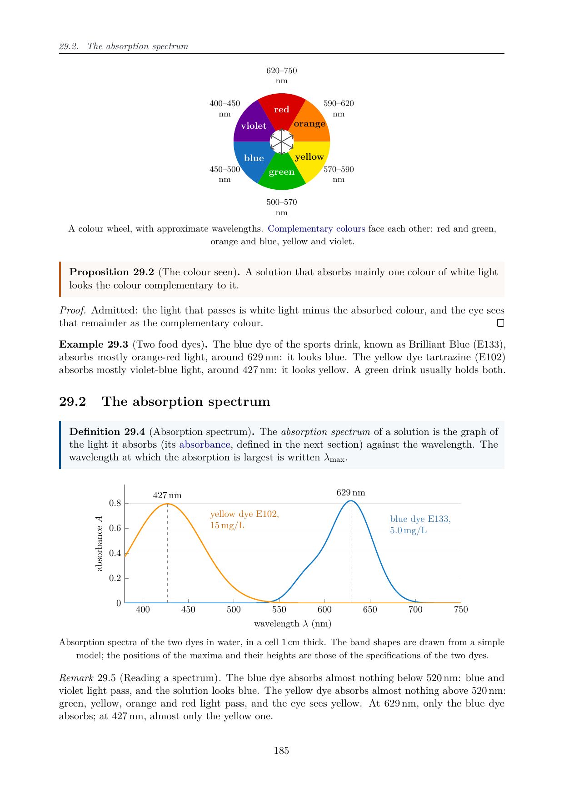
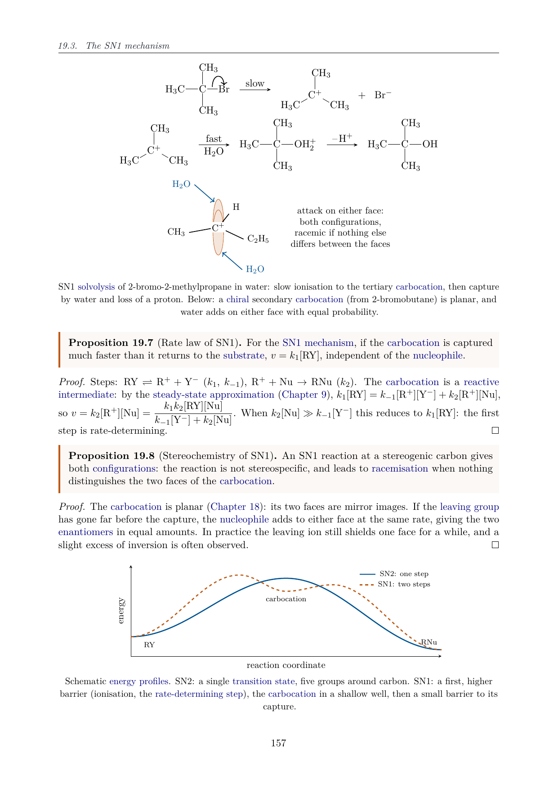
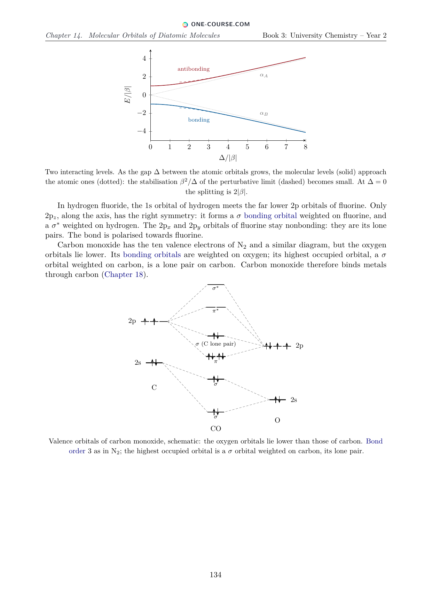

# One Chemistry Book

<p align="center">
  <a href="https://one-course.com">
    
  </a>
</p>

<p align="center">
  <a href="https://github.com/bvirrion/one-chemistry-book/releases/latest"></a>
  <a href="https://github.com/bvirrion/one-chemistry-book/releases"></a>
  <a href="https://github.com/bvirrion/one-chemistry-book/actions/workflows/release.yml"></a>
  <a href="https://one-course.com/books"></a>
</p>

*The One Chemistry Book to Rule Them All.*

> **One Chemistry Book** is part of the **One Course** project — one coherent
> course covering each subject from kindergarten to the end of the
> bachelor's degree. Discover the whole project at
> **[one-course.com](https://one-course.com)**, and see the siblings
> [One Math Book](https://github.com/bvirrion/one-math-book),
> [One Physics Book](https://github.com/bvirrion/one-physics-book),
> [One Biology Book](https://github.com/bvirrion/one-biology-book),
> [One Earth and Space Sciences Book](https://github.com/bvirrion/one-earth-and-space-sciences-book),
> [One Computer Science Book](https://github.com/bvirrion/one-computer-science-book),
> [One Economics Book](https://github.com/bvirrion/one-economics-book) and
> [One Quant Book](https://github.com/bvirrion/one-quant-book).

A series of four **free chemistry textbooks** forming a single coherent
course **from Grade 1 to the end of the bachelor's degree** — one notation,
one voice, every year building on the previous one. Each book is available in
eight complete editions: **English, French, Dutch, Spanish, Portuguese, Hindi, Arabic and Indonesian**, plus a
**Simplified Chinese** edition (PDF only for now). Whether you are a student,
a parent, a teacher or a homeschooling family, you can read every book online
or download the PDF — free of charge:

1. **School Chemistry** — Grades 1–12, in one volume;
2. **University Chemistry — Year 1**;
3. **University Chemistry — Year 2**;
4. **University Chemistry — Year 3**.

The course is **pure chemistry**: states of matter, density, heat and
radioactivity belong to the physics series and are only recalled here. The
school volume **never repeats itself** — each notion has one chapter that owns
it, and a later chapter that needs it opens with a short recall box and adds
only what is new.

The style is concise and rigorous: courses built from **definitions,
examples, propositions and methods**, followed by graded **exercises and a
weekend problem with full solutions** collected at the end of each book.

- **Chemistry typeset as chemistry.** Every reaction equation is checked for
  balance (atoms and charge) by a script; structures, mechanisms with their
  curly arrows,
  Newman and chair projections, crystal cells and orbital diagrams are drawn
  exactly, never pasted as pictures.
- **Sourced numbers.** Every measured value printed in a book (atomic weights,
  constants, thermodynamic data, spectra positions) goes through a data ledger
  that names its source and access date: about 1,900 rows.
- **Curves you can reproduce.** Every plotted curve comes from a tested
  script in the repository.
- **Safety first.** Each university book has a chapter of laboratory
  techniques; hazards are marked with their pictograms, and no chapter asks
  the reader to run an experiment at home.

Thousands of generated hyperlinks send every defined term back to its
definition, and every exercise to its solution.

<p align="center">
  
  
  
</p>
<p align="center"><sub>Three pages: colour and absorption (Book 1), the SN1 mechanism (Book 2), molecular orbitals (Book 3).</sub></p>

## Read online · Download the PDFs

| Book | Read online | Download PDF |
|------|-------------|--------------|
| **1. School Chemistry** (Grades 1–12) | [EN](https://one-course.com/books/chemistry/1/en) · [ES](https://one-course.com/books/chemistry/1/es) · [FR](https://one-course.com/books/chemistry/1/fr) · [HI](https://one-course.com/books/chemistry/1/hi) · [AR](https://one-course.com/books/chemistry/1/ar) · [ID](https://one-course.com/books/chemistry/1/id) · [NL](https://one-course.com/books/chemistry/1/nl) · [PT](https://one-course.com/books/chemistry/1/pt) | [EN](https://github.com/bvirrion/one-chemistry-book/releases/latest/download/one_chemistry_book_1_school.pdf) · [ES](https://github.com/bvirrion/one-chemistry-book/releases/latest/download/one_chemistry_book_1_school_es.pdf) · [FR](https://github.com/bvirrion/one-chemistry-book/releases/latest/download/one_chemistry_book_1_school_fr.pdf) · [HI](https://github.com/bvirrion/one-chemistry-book/releases/latest/download/one_chemistry_book_1_school_hi.pdf) · [AR](https://github.com/bvirrion/one-chemistry-book/releases/latest/download/one_chemistry_book_1_school_ar.pdf) · [ID](https://github.com/bvirrion/one-chemistry-book/releases/latest/download/one_chemistry_book_1_school_id.pdf) · [NL](https://github.com/bvirrion/one-chemistry-book/releases/latest/download/one_chemistry_book_1_school_nl.pdf) · [PT](https://github.com/bvirrion/one-chemistry-book/releases/latest/download/one_chemistry_book_1_school_pt.pdf) · [ZH](https://github.com/bvirrion/one-chemistry-book/releases/latest/download/one_chemistry_book_1_school_zh.pdf) |
| **2. University — Year 1** | [EN](https://one-course.com/books/chemistry/2/en) · [ES](https://one-course.com/books/chemistry/2/es) · [FR](https://one-course.com/books/chemistry/2/fr) · [HI](https://one-course.com/books/chemistry/2/hi) · [AR](https://one-course.com/books/chemistry/2/ar) · [ID](https://one-course.com/books/chemistry/2/id) · [NL](https://one-course.com/books/chemistry/2/nl) · [PT](https://one-course.com/books/chemistry/2/pt) | [EN](https://github.com/bvirrion/one-chemistry-book/releases/latest/download/one_chemistry_book_2_university_year_1.pdf) · [ES](https://github.com/bvirrion/one-chemistry-book/releases/latest/download/one_chemistry_book_2_university_year_1_es.pdf) · [FR](https://github.com/bvirrion/one-chemistry-book/releases/latest/download/one_chemistry_book_2_university_year_1_fr.pdf) · [HI](https://github.com/bvirrion/one-chemistry-book/releases/latest/download/one_chemistry_book_2_university_year_1_hi.pdf) · [AR](https://github.com/bvirrion/one-chemistry-book/releases/latest/download/one_chemistry_book_2_university_year_1_ar.pdf) · [ID](https://github.com/bvirrion/one-chemistry-book/releases/latest/download/one_chemistry_book_2_university_year_1_id.pdf) · [NL](https://github.com/bvirrion/one-chemistry-book/releases/latest/download/one_chemistry_book_2_university_year_1_nl.pdf) · [PT](https://github.com/bvirrion/one-chemistry-book/releases/latest/download/one_chemistry_book_2_university_year_1_pt.pdf) · [ZH](https://github.com/bvirrion/one-chemistry-book/releases/latest/download/one_chemistry_book_2_university_year_1_zh.pdf) |
| **3. University — Year 2** | [EN](https://one-course.com/books/chemistry/3/en) · [ES](https://one-course.com/books/chemistry/3/es) · [FR](https://one-course.com/books/chemistry/3/fr) · [HI](https://one-course.com/books/chemistry/3/hi) · [AR](https://one-course.com/books/chemistry/3/ar) · [ID](https://one-course.com/books/chemistry/3/id) · [NL](https://one-course.com/books/chemistry/3/nl) · [PT](https://one-course.com/books/chemistry/3/pt) | [EN](https://github.com/bvirrion/one-chemistry-book/releases/latest/download/one_chemistry_book_3_university_year_2.pdf) · [ES](https://github.com/bvirrion/one-chemistry-book/releases/latest/download/one_chemistry_book_3_university_year_2_es.pdf) · [FR](https://github.com/bvirrion/one-chemistry-book/releases/latest/download/one_chemistry_book_3_university_year_2_fr.pdf) · [HI](https://github.com/bvirrion/one-chemistry-book/releases/latest/download/one_chemistry_book_3_university_year_2_hi.pdf) · [AR](https://github.com/bvirrion/one-chemistry-book/releases/latest/download/one_chemistry_book_3_university_year_2_ar.pdf) · [ID](https://github.com/bvirrion/one-chemistry-book/releases/latest/download/one_chemistry_book_3_university_year_2_id.pdf) · [NL](https://github.com/bvirrion/one-chemistry-book/releases/latest/download/one_chemistry_book_3_university_year_2_nl.pdf) · [PT](https://github.com/bvirrion/one-chemistry-book/releases/latest/download/one_chemistry_book_3_university_year_2_pt.pdf) · [ZH](https://github.com/bvirrion/one-chemistry-book/releases/latest/download/one_chemistry_book_3_university_year_2_zh.pdf) |
| **4. University — Year 3** | [EN](https://one-course.com/books/chemistry/4/en) · [ES](https://one-course.com/books/chemistry/4/es) · [FR](https://one-course.com/books/chemistry/4/fr) · [HI](https://one-course.com/books/chemistry/4/hi) · [AR](https://one-course.com/books/chemistry/4/ar) · [ID](https://one-course.com/books/chemistry/4/id) · [NL](https://one-course.com/books/chemistry/4/nl) · [PT](https://one-course.com/books/chemistry/4/pt) | [EN](https://github.com/bvirrion/one-chemistry-book/releases/latest/download/one_chemistry_book_4_university_year_3.pdf) · [ES](https://github.com/bvirrion/one-chemistry-book/releases/latest/download/one_chemistry_book_4_university_year_3_es.pdf) · [FR](https://github.com/bvirrion/one-chemistry-book/releases/latest/download/one_chemistry_book_4_university_year_3_fr.pdf) · [HI](https://github.com/bvirrion/one-chemistry-book/releases/latest/download/one_chemistry_book_4_university_year_3_hi.pdf) · [AR](https://github.com/bvirrion/one-chemistry-book/releases/latest/download/one_chemistry_book_4_university_year_3_ar.pdf) · [ID](https://github.com/bvirrion/one-chemistry-book/releases/latest/download/one_chemistry_book_4_university_year_3_id.pdf) · [NL](https://github.com/bvirrion/one-chemistry-book/releases/latest/download/one_chemistry_book_4_university_year_3_nl.pdf) · [PT](https://github.com/bvirrion/one-chemistry-book/releases/latest/download/one_chemistry_book_4_university_year_3_pt.pdf) · [ZH](https://github.com/bvirrion/one-chemistry-book/releases/latest/download/one_chemistry_book_4_university_year_3_zh.pdf) |

The eight complete editions of every book can be read online, chapter by
chapter (the Chinese edition is PDF only for now, and is a first pass: please
report anything that reads wrong). The PDF links always point at the newest
release. Spotted a mistake in any book? Please
[report an erratum](https://github.com/bvirrion/one-chemistry-book/issues/new?template=errata.yml) —
fixes usually ship within days.

## Current status

**All four books are written, and every one ships in eight complete
editions** (same chapters, same labels, same figures): 146 chapters in all.

| Book | Level | Status |
|------|-------|--------|
| School Chemistry | Grades 1–12 (age 6–18) | ✅ 49 chapters, 665 exercises, 42 weekend problems, solutions — about 430 pages |
| University — Year 1 | Bachelor Year 1 (age 18–19) | ✅ 29 chapters, 348 exercises, 29 weekend problems, solutions — about 295 pages |
| University — Year 2 | Bachelor Year 2 (age 19–20) | ✅ 35 chapters, 420 exercises, 35 weekend problems, solutions — about 375 pages |
| University — Year 3 | Bachelor Year 3 (age 20–21) | ✅ 33 chapters, 396 exercises, 33 weekend problems, solutions — about 405 pages |

## Building the books

Requirements: a TeX Live installation with `latexmk` (packages used:
`mhchem`, `chemfig`, `modiagram`, `tcolorbox`, `pgfplots`, `siunitx`, …).

```sh
make            # or just: latexmk — builds all books
```

The PDFs are produced at

```
build/one_chemistry_book_<N>_<slug>[_<lang>].pdf
```

with `N` = 1–4, `slug` ∈ {`school`, `university_year_1`, `university_year_2`,
`university_year_3`} and `lang` ∈ {`fr`, `nl`, `es`, `pt`, `hi`, `ar`, `id`,
`zh`} (no suffix for English) — 36 PDFs in total. The Hindi editions compile
with XeLaTeX (Devanagari), the Simplified Chinese editions with XeLaTeX and
xeCJK (Fandol fonts from TeX Live), and the Arabic editions with LuaLaTeX
(right-to-left, fonts bundled under `assets/fonts/`); everything else is
pdflatex. To build a single book, e.g.
`latexmk one_chemistry_book_2_university_year_1.tex`.

The checks beside the build:

```sh
make venv       # create .venv (numpy, pytest)
make gates      # chapter gates: exercise ↔ solution, labels, balanced equations, ledger ids
make test       # the tests of the plotted curves
make figdata    # regenerate every curve's data: must leave no diff
```

## Repository layout

```
one_chemistry_book_<N>_*.tex   entry file per book / language (N = series number)
styles/onechemistry.sty        packages, environments, macros, glassware and crystal drawings
styles/lang/<lang>.tex         UI strings (en, fr, nl, es, pt, hi, ar, id, zh)
frontmatter/                   title page, preface, image credits (shared layout)
parts/<year>/part.tex          shared structure for a year
parts/<year>/NN-*.tex          English chapter
parts/<year>/<lang>/NN-*.tex   translated chapter (same labels)
parts/<year>/solutions/        English + <lang>/ solutions
figdata/, tests/               the scripts behind every plotted curve, and their tests
sources/                       the data ledger (shared rows + one file per book)
images/book<N>/                photographs and illustrations, with credits
tools/                         gates, term linker, HTML reader converter
```

## Contributing

Contributions are welcome — corrections, better drawings, additional exercises, new chapters. Please read
[CONTRIBUTING.md](CONTRIBUTING.md) for the structure, environments and
style conventions of the project. The fastest way to help is to
[report an erratum](https://github.com/bvirrion/one-chemistry-book/issues/new?template=errata.yml)
when you spot a mistake.

## Contributors

- Benjamin Virrion
- Claude (Anthropic)

## License

- **How to credit**: One Chemistry Book, One Course (one-course.com).
- **Book content** — the LaTeX sources, figures, and the PDF and HTML editions — is licensed under
  [Creative Commons Attribution-NonCommercial-ShareAlike 4.0](https://creativecommons.org/licenses/by-nc-sa/4.0/)
  (CC BY-NC-SA 4.0): you may share and adapt it, including translating it, with credit to
  One Chemistry Book, for non-commercial purposes, and adaptations must use the same licence. See [`LICENSE`](LICENSE).
- **Software** — `tools/`, `.github/`, the `Makefile` and the build scripts — is licensed under the MIT licence: see [`LICENSE-CODE`](LICENSE-CODE).
- **Third-party material** (photographs, public-domain images, bundled fonts) keeps its own licence, as listed in
  the books' image-credit pages.
- **Names and logos**: "One Course" and "One Chemistry Book" are not covered by these licences.
- **Commercial use** (print editions, licences for schools, publishers or companies): contact One Course via [one-course.com/contact](https://one-course.com/contact).

Contributions are accepted under these licences with a signed-off commit — see
[`CONTRIBUTING.md`](CONTRIBUTING.md#licensing-of-contributions).
